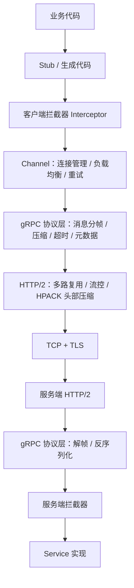
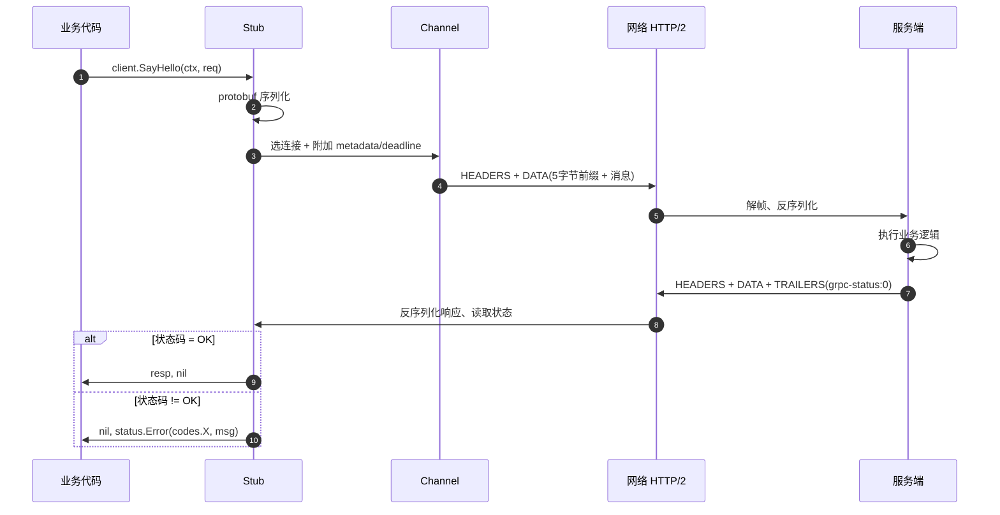

# gRPC 入门学习指南：是什么 → 原理 → 怎么用

> 面向初学者的核心梳理，目标是三件事：
> 1. 用自己的话说清楚 **gRPC 是什么、解决了什么问题**；
> 2. 看懂一次 gRPC 调用 **在网络层到底发生了什么**；
> 3. 能 **从零跑通一个 Hello World**，并知道生产环境要注意什么。
>
> 配套阅读：[protobuf入门指南.md](protobuf入门指南.md)（gRPC 的序列化底座，本文只讲到够用为止）。

---

## 0. 先记住三句话

1. **gRPC = 用 `.proto` 定义接口 + 自动生成客户端/服务端代码 + 通过 HTTP/2 传输二进制消息的远程调用框架。**
2. 它把"调用远程服务"做得**像调用本地函数一样**：`resp, err := client.SayHello(ctx, req)`。
3. 它的两大支柱是 **Protocol Buffers（契约与编码）** 和 **HTTP/2（传输）**，剩下的都是围绕这两者做的工程能力（超时、负载均衡、拦截器、流式……）。

---

## 目录

1. [gRPC 是什么](#1-grpc-是什么)
2. [为什么要用 gRPC（和 REST 对比）](#2-为什么要用-grpc和-rest-对比)
3. [核心原理](#3-核心原理)
   - 3.1 全景分层 / 3.2 Protobuf 契约 / 3.3 HTTP/2 传输 / 3.4 代码生成与 Stub
   - 3.5 一次调用的完整生命周期 / 3.6 四种通信模式
   - 3.7 连接、负载均衡与服务发现 / 3.8 超时与取消 / 3.9 元数据
   - 3.10 拦截器 / 3.11 状态码与错误模型 / 3.12 安全
4. [动手：从零跑通 Hello World](#4-动手从零跑通-hello-world)
5. [proto3 语法速查（gRPC 视角）](#5-proto3-语法速查grpc-视角)
6. [进阶用法](#6-进阶用法)
7. [生产实践与常见坑](#7-生产实践与常见坑)
8. [生态与工具](#8-生态与工具)
9. [学习路线](#9-学习路线)
10. [自测题](#10-自测题)
11. [术语表](#11-术语表)

---

## 1. gRPC 是什么

### 1.1 一句话定义

**gRPC 是一个高性能、开源、通用的 RPC（Remote Procedure Call，远程过程调用）框架。** 你在 `.proto` 文件里写"有哪些方法、参数是什么、返回什么"，工具链就会为你生成强类型的客户端和服务端代码，让跨进程、跨语言、跨机房的调用看起来像本地函数调用。

它由 Google 在 **2015 年** 开源，前身是 Google 内部用了十几年的 RPC 基础设施 **Stubby**。现在它是 CNCF 孵化项目，是云原生时代服务间通信的事实标准之一。

### 1.2 它由三块拼起来

| 组成 | 作用 | 类比 |
| --- | --- | --- |
| **IDL（`.proto` 文件）** | 定义服务、方法、消息结构，是双方共享的"契约" | 合同/接口文档，而且是**可执行**的 |
| **代码生成器（protoc + 插件）** | 由契约自动生成各语言的 Stub 和骨架代码 | 自动化的"翻译 + 脚手架" |
| **运行时 + 传输（HTTP/2）** | 负责序列化、连接复用、超时、流控、错误传递 | 快递网络 |

> 注意：**gRPC 不等于 protobuf**。protobuf 是默认的序列化格式（codec），gRPC 允许替换成 JSON、FlatBuffers 等，只是绝大多数人用 protobuf。

### 1.3 核心特征速览

- **强类型契约**：编译期就能发现字段写错、类型不匹配，而不是等到线上 500。
- **跨语言**：同一份 `.proto`，Go / Java / Python / C++ / C# / Node / Rust / PHP / Dart 都能生成代码。
- **高性能**：二进制编码体积小，HTTP/2 多路复用减少连接数，头部压缩减少冗余。
- **原生流式**：一元、服务端流、客户端流、双向流四种模式，都是协议级支持。
- **工程能力齐全**：截止时间（deadline）、取消（cancel）、元数据（metadata）、拦截器（interceptor）、负载均衡、重试、健康检查、反射。
- **代码即文档**：接口定义不会和实现漂移。

> 花絮：gRPC 里的 "g" 官方说**每个版本含义都不同**（good、green、glorious……），不用纠结。

### 1.4 一个最小的 gRPC 契约长什么样

```proto
syntax = "proto3";

package helloworld;

// 服务 = 一组方法
service Greeter {
  rpc SayHello (HelloRequest) returns (HelloReply);
}

// 消息 = 数据结构
message HelloRequest {
  string name = 1;
}

message HelloReply {
  string message = 1;
}
```

生成代码后，客户端就能这样调用：

```go
resp, err := client.SayHello(ctx, &pb.HelloRequest{Name: "World"})
```

```python
resp = stub.SayHello(helloworld_pb2.HelloRequest(name="World"), timeout=5)
```

**"像本地函数一样"就是 gRPC 的全部卖点**，剩下的内容都是在解释这句话背后藏了多少东西。

---

## 2. 为什么要用 gRPC（和 REST 对比）

### 2.1 REST/JSON 的典型痛点

假设你有 20 个微服务，彼此调用都用 REST + JSON：

1. **接口契约靠文档和自觉**：字段改名、类型从 int 变 string，编译器不管你，上线才炸。
2. **序列化开销大**：字段名每次都重复传输，文本解析要逐字符扫描。
3. **每个请求一个连接或依赖连接池**：HTTP/1.1 下并发靠多连接堆。
4. **流式能力弱**：要么轮询，要么 SSE/WebSocket 自己造轮子。
5. **客户端代码手写**：20 个服务 × N 种语言，重复劳动且容易写错。

gRPC 正是针对"**内部服务之间高频、强类型、多语言、低延迟**"这个场景设计的。

### 2.2 对比表

| 维度 | REST + JSON | gRPC |
| --- | --- | --- |
| 契约 | OpenAPI 文档（可选，易漂移） | `.proto`（强制，生成代码） |
| 传输协议 | 通常 HTTP/1.1，也可 HTTP/2 | **必须 HTTP/2**（gRPC-Web 例外） |
| 编码 | 文本 JSON | 二进制 protobuf（可换 codec） |
| 体积 | 较大（含字段名） | 通常小 30%~70%（取决于字段类型） |
| 解析速度 | 较慢 | 通常更快（数值多、字段多时优势明显） |
| 代码生成 | 可选（openapi-generator） | **核心机制** |
| 流式 | 靠 SSE / WebSocket / chunked 变通 | 四种模式原生支持 |
| 浏览器直连 | ✅ 原生 | ❌ 需 gRPC-Web / Connect / 网关 |
| 人类可读性 | ✅ 肉眼可读 | ❌ 需要工具（grpcurl 等） |
| HTTP 缓存 | ✅ 生态成熟 | ❌ 基本用不上（POST + 二进制） |
| 调试成本 | 低（curl 就行） | 中（需要 grpcurl/grpcui/反射） |
| 负载均衡 | L7 代理成熟 | 客户端 LB 或 L7 代理（Envoy 等） |
| 典型场景 | 对外 API、简单 CRUD、第三方集成 | 内部微服务、低延迟、多语言、流式 |

### 2.3 什么时候该用 / 不该用

**适合 gRPC：**

- 内部微服务之间的同步调用（尤其是高频、低延迟）。
- 多语言技术栈，需要统一契约。
- 需要**流式**：日志推送、大文件分块、实时订阅、双向对话。
- 移动端/物联网等**带宽敏感**场景。
- 想用 **代码生成** 消灭手写 HTTP 客户端。

**不适合 gRPC：**

- **要给浏览器前端直接调用**（除非引入 gRPC-Web/Connect/网关，多一层复杂度）。
- **公开 API / 第三方开放平台**：对方未必有 gRPC 客户端，curl 调试也不方便。
- **简单 CRUD、低频调用**：上 gRPC 的收益小于心智成本。
- **需要 HTTP 缓存、CDN 缓存**的场景。
- 团队里没人愿意维护 `.proto` 和工具链（这确实是真实成本）。

> 结论：**gRPC 不是 REST 的替代品，而是补充。** 常见架构是"对外 REST，对内 gRPC"。

---

## 3. 核心原理

### 3.1 全景分层



关键认识：**gRPC 不是新造了一个传输协议，而是"HTTP/2 之上的一套约定"**（约定路径格式、content-type、消息分帧、状态放在 trailer 里）。理解这一点，很多问题就通了。

### 3.2 第一根支柱：Protocol Buffers（契约 + 编码）

protobuf 解决两件事：**怎么描述数据**、**怎么把数据变成字节**。

**(1) 描述数据**：`.proto` 是强类型 IDL，字段用**编号**而非名字标识。

```proto
message User {
  int64  id    = 1;   // 编号 1
  string name  = 2;   // 编号 2
  string email = 3;   // 编号 3
}
```

**(2) 编码数据**：二进制 wire format，每个字段 = `tag + 值`，`tag = (字段编号 << 3) | 线类型`。

例如 `HelloRequest{name: "World"}` 编码后只有 7 个字节：

```
0A 05 57 6F 72 6C 64
│  │  └────────────── "World" 的 ASCII
│  └─ 长度 5
└──── tag: 字段1 + wire type 2（长度分隔）
```

对比 JSON 的 `{"name":"World"}` 是 16 字节，而且还要解析引号和冒号。**编号代替字段名**是它体积小的根本原因。

**(3) 兼容性铁律**（这是初学者最容易踩的坑）：

- ✅ 可以**新增**字段（旧代码忽略未知字段，不影响运行）。
- ✅ 可以**删除**字段，但必须用 `reserved` 占住编号，防止别人复用。
- ❌ **绝不能修改已发布字段的编号**。
- ❌ **绝不能把字段编号给另一个字段复用**（老数据/老客户端会解析错）。
- ⚠️ 改类型要谨慎（`int32` ↔ `int64` 通常安全，`string` ↔ `bytes` 在 UTF-8 下兼容，其它组合可能出问题）。

> 编码细节（varint、zigzag、packed、未知字段处理）在 [protobuf入门指南.md](protobuf入门指南.md) 里有完整展开，这里只保留 gRPC 必需的部分。

### 3.3 第二根支柱：HTTP/2（传输）

gRPC 选 HTTP/2 不是随便选的，而是因为它刚好提供了 RPC 需要的东西：

| HTTP/2 特性 | 对 gRPC 的意义 |
| --- | --- |
| **二进制分帧** | 消息可以切成帧交错发送，天然支持流式 |
| **多路复用（Stream）** | 一个 TCP 连接上并发跑成百上千个请求，不再需要连接池堆数量 |
| **HPACK 头部压缩** | 重复的 header（`:path`、`content-type`、认证信息）只传一次索引 |
| **流量控制** | 按 stream 和 connection 双维度背压，防止慢消费者被压垮 |
| **Trailer 支持** | 关键！gRPC 把最终状态码放在 trailer 里（HTTP/1.1 做不到优雅实现） |

#### 3.3.1 一个 gRPC 请求在 HTTP/2 上长什么样

**请求头（HEADERS 帧）**：

```
:method: POST
:scheme: http
:path: /helloworld.Greeter/SayHello      ← 路径 = /{package}.{Service}/{Method}
:authority: localhost:50051
content-type: application/grpc
te: trailers                              ← 告诉中间设备"我要收 trailer"
grpc-timeout: 5S                          ← 截止时间，服务端可读取
grpc-encoding: identity
user-agent: grpc-go/1.x
```

**请求体（DATA 帧）**：注意每条消息前面有 **5 字节前缀**：

```
┌──────────┬────────────────────┬──────────────────────┐
│ 1 字节    │ 4 字节大端长度       │ 消息体（protobuf 字节） │
│ 压缩标志  │ (消息长度)           │                       │
└──────────┴────────────────────┴──────────────────────┘
```

这个分帧格式让"一条连接上交错传输多条消息"成为可能，也是流式的基础。

**响应**：HEADERS（响应头）+ 若干 DATA 帧 + **TRAILERS**（`grpc-status`、`grpc-message`）。

```
grpc-status: 0
grpc-message: (空)
```

> 如果服务端在返回任何消息之前就出错了，会返回一个 **"Trailers-Only" 响应**（只有 HEADERS + TRAILERS，没有 DATA），这就是为什么 gRPC 的错误能携带结构化状态码而不是只有 HTTP 4xx/5xx。

#### 3.3.2 为什么浏览器不能直接调 gRPC

因为浏览器**不暴露 HTTP/2 的帧和 trailer 控制能力**——JS 的 `fetch` 拿不到 trailer，也无法控制流的帧。所以需要：

- **gRPC-Web**：协议的子集，用 body 尾部或 header 携带状态，需要 `envoy`/`grpc-web` 代理转译；
- **Connect**（Buf 出品）：同时兼容 gRPC、gRPC-Web 和普通 HTTP/JSON，浏览器友好；
- **grpc-gateway**：把 REST/JSON 反向代理成 gRPC（服务端加一层）。

### 3.4 代码生成与 Stub

`.proto` 是唯一真相源，工具链生成两类代码：

| 生成物 | 客户端 | 服务端 |
| --- | --- | --- |
| 消息类 | `HelloRequest` / `HelloReply` 的序列化代码 | 同左 |
| Stub | `GreeterClient`：有 `SayHello()` 方法，内部完成序列化+发送+反序列化 | `GreeterServer` 接口 + `RegisterGreeterServer()` |

调用时你看到的 `client.SayHello(...)` 其实做了 8 件事：

1. 序列化请求消息 → 2. 组装 metadata/deadline → 3. 从 Channel 选一个可用连接 → 4. 编码成 5 字节前缀 + DATA 帧 → 5. 通过 HTTP/2 发送 → 6. 等待响应并反序列化 → 7. 检查 `grpc-status` → 8. 返回结果或 `status.Error`。

> **Channel** 是一个"虚拟连接"，内部管理真实 TCP 连接、子通道（subchannel）和负载均衡策略。它线程安全、可复用，**应该长期持有，不要每次调用都创建**。

### 3.5 一次 Unary（一元）调用的完整生命周期



**关键点**：错误不是靠 `err.Error()` 字符串判断，而是靠**状态码**（见 3.11）。

### 3.6 四种通信模式

| 模式 | proto 写法 | 客户端 | 服务端 | 典型场景 |
| --- | --- | --- | --- | --- |
| **一元 Unary** | `rpc F(Req) returns (Res)` | 发 1 收 1 | 收 1 回 1 | 绝大多数 CRUD |
| **服务端流** | `rpc F(Req) returns (stream Res)` | 发 1 收 N | 收 1 回 N | 日志推送、分页拉取、订阅 |
| **客户端流** | `rpc F(stream Req) returns (Res)` | 发 N 收 1 | 收 N 回 1 | 大文件分块上传、聚合上报 |
| **双向流** | `rpc F(stream Req) returns (stream Res)` | 发 N 收 N | 收 N 回 N | 实时对话、协同编辑、语音 |

**记忆技巧**：`stream` 关键字写在**谁那一侧**，就是谁可以发多条。

```proto
service Uploader {
  rpc Get (GetReq) returns (GetRes);                          // 一元
  rpc List (ListReq) returns (stream Item);                   // 服务端流
  rpc Upload (stream Chunk) returns (UploadRes);              // 客户端流
  rpc Chat (stream Msg) returns (stream Msg);                 // 双向流
}
```

> 流式是 gRPC 相对 REST 最大的能力差异。双向流在 HTTP/2 上表现为同一个 stream 上的双向 DATA 帧交错，天然全双工。

### 3.7 连接、负载均衡与服务发现

- **连接是长连接**：一个 Channel 通常只需要 1 条（或少数几条）TCP 连接，就能承载大量并发请求。
- **客户端负载均衡**：Channel 通过 **Resolver（名字解析）** 拿到一组后端地址，再由 **LB 策略** 选一个。
  - `pick_first`（默认）：选第一个能连上的，全量压给它。
  - `round_robin`：轮询。
  - `xDS`：对接 Envoy/Istio 的控制面。
- **服务发现**：DNS（`dns:///my-svc:50051` + K8s headless Service）、etcd/Consul/Nacos 自定义 Resolver、xDS。
- **代理侧 LB**：也可以用 Envoy / Nginx / 云厂商 ALB 做 L7 负载均衡，此时客户端只需连代理。

```go
// Go：开启轮询负载均衡
conn, _ := grpc.NewClient("dns:///my-svc:50051",
    grpc.WithDefaultServiceConfig(`{"loadBalancingConfig":[{"round_robin":{}}]}`),
    grpc.WithTransportCredentials(insecure.NewCredentials()),
)
```

> 坑：如果用 K8s 普通 Service（ClusterIP），DNS 只解析出一个 VIP，round_robin 就变成"只连一个 Pod"。需要 **headless Service** 或用服务网格。

### 3.8 超时与取消：分布式系统的保命符

gRPC 用 **Deadline**（绝对截止时间），不是 timeout（相对时长），因为它在链路中**可传播**。

- 客户端设置 5s 截止时间；
- 服务端收到 `grpc-timeout`，若剩余 1s，它再调用下游时只能用这 1s；
- 超时后，客户端返回 `DEADLINE_EXCEEDED`，服务端的 `ctx` 也会被取消（业务应监听 `ctx.Done()` 及时退出，别再白算）。

```go
// Go 客户端
ctx, cancel := context.WithTimeout(context.Background(), 5*time.Second)
defer cancel()
resp, err := client.SayHello(ctx, req)

// Go 服务端：尊重上下文
select {
case <-ctx.Done():
    return nil, status.FromContextError(ctx.Err()).Err()
default:
}
```

```python
# Python 客户端
stub.SayHello(req, timeout=5)
```

> **永远设 deadline**。没有超时的 RPC 会一直占着连接和 goroutine/线程，是线上雪崩的经典起点。

### 3.9 Metadata：gRPC 的"请求头"

Metadata 是 key-value 字符串对，用来传 **trace-id、认证 token、租户 ID** 等非业务数据。

- key **必须小写**（HTTP/2 要求），`-bin` 结尾的 key 值会做 base64 编码（可传二进制）。
- 对应 HTTP/2 的 header（发送时）和 trailer（状态相关）。

```go
// 客户端发送
ctx = metadata.AppendToOutgoingContext(ctx, "authorization", "Bearer xxx")
// 服务端读取
md, ok := metadata.FromIncomingContext(ctx)
token := md.Get("authorization")
```

```python
# Python
metadata = (("authorization", "Bearer xxx"),)
stub.SayHello(req, metadata=metadata, timeout=5)
```

> 大块业务数据不要塞 metadata（有大小限制，且不参与压缩优化），业务数据走消息体。

### 3.10 拦截器（Interceptor）：gRPC 的中间件

拦截器可以在调用前后插入逻辑，是**日志、链路追踪、鉴权、限流、指标**的标准落点。

```go
func loggingInterceptor(ctx context.Context, req any, info *grpc.UnaryServerInfo, handler grpc.UnaryHandler) (any, error) {
    start := time.Now()
    resp, err := handler(ctx, req)
    log.Printf("method=%s dur=%s code=%s", info.FullMethod, time.Since(start), status.Code(err))
    return resp, err
}

s := grpc.NewServer(grpc.UnaryInterceptor(loggingInterceptor))
```

- **一元拦截器**：`UnaryInterceptor` / `UnaryClientInterceptor`
- **流拦截器**：`StreamInterceptor` / `StreamClientInterceptor`（需要包装 `ServerStream`）
- 多个拦截器串联：`grpc.ChainUnaryInterceptor(a, b, c)`

> 顺序很重要：客户端拦截器按注册顺序**从外到内**，服务端反之。鉴权拦截器一般放最外层。

### 3.11 状态码与错误模型

gRPC 有独立的 17 个状态码（`google.golang.org/grpc/codes`），比 HTTP 状态码表达力更强：

| 码 | 名称 | 含义 | 客户端该怎么做 |
| --- | --- | --- | --- |
| 0 | `OK` | 成功 | — |
| 1 | `CANCELLED` | 被取消（通常是客户端主动） | 一般忽略 |
| 2 | `UNKNOWN` | 未知错误 | 记录，别重试 |
| 3 | `INVALID_ARGUMENT` | 参数非法 | **不要重试**，是调用方 bug |
| 4 | `DEADLINE_EXCEEDED` | 超时 | 谨慎重试（注意幂等） |
| 5 | `NOT_FOUND` | 资源不存在 | 不要重试 |
| 6 | `ALREADY_EXISTS` | 已存在 | 不要重试 |
| 7 | `PERMISSION_DENIED` | 无权限 | 不要重试 |
| 8 | `RESOURCE_EXHAUSTED` | 限流/配额耗尽 | 退避后重试 |
| 9 | `FAILED_PRECONDITION` | 状态不满足前置条件 | 不要重试 |
| 10 | `ABORTED` | 并发冲突（如版本号冲突） | 可以重试 |
| 11 | `OUT_OF_RANGE` | 越界 | 不要重试 |
| 12 | `UNIMPLEMENTED` | 服务端没实现 | 不要重试 |
| 13 | `INTERNAL` | 内部错误 | 谨慎重试 |
| 14 | `UNAVAILABLE` | 暂时不可用（连接失败/过载） | **重试 + 退避** |
| 15 | `DATA_LOSS` | 数据丢失/损坏 | 不要重试，告警 |
| 16 | `UNAUTHENTICATED` | 未认证 | 刷新凭证后重试 |

**黄金规则**：**只有 `UNAVAILABLE`、`DEADLINE_EXCEEDED`、`ABORTED`、`RESOURCE_EXHAUSTED` 这类"临时性"错误才值得重试，且必须保证操作幂等。**

```go
// 服务端返回
return nil, status.Errorf(codes.NotFound, "user %d not found", id)

// 客户端判断
if st, ok := status.FromError(err); ok {
    switch st.Code() {
    case codes.NotFound:
        // 业务处理
    case codes.Unavailable:
        // 重试
    }
}
```

```python
try:
    stub.SayHello(req)
except grpc.RpcError as e:
    print(e.code(), e.details())   # StatusCode.NOT_FOUND, "..."
```

> 禁止把业务错误硬编码成字符串再 `errors.New` 返回——那样客户端只能拿到 `UNKNOWN`，无法做差异化处理。

### 3.12 安全：TLS 与 mTLS

- **传输加密**：gRPC 原生基于 HTTP/2，加 TLS 只是标准做法（`credentials.NewTLS(...)`）。
- **mTLS（双向认证）**：服务端也校验客户端证书，适用于零信任内网；用 SPIFFE/istio 自动轮转证书很常见。
- **认证**：JWT/OAuth2 token 通常放 metadata 的 `authorization`，配合拦截器统一校验。
- **明文（insecure）只用于本地开发**，线上必须 TLS 或走内网 mTLS/服务网格。

```go
creds, err := credentials.NewClientTLSFromFile("ca.crt", "")
conn, err := grpc.NewClient("api.example.com:443", grpc.WithTransportCredentials(creds))
```

---

## 4. 动手：从零跑通 Hello World

下面给 **Python**（最快看到效果）和 **Go**（生产最常用）两个版本，任选其一。

### 4.1 环境准备

**Python**

```bash
python -m venv .venv
# Windows: .venv\Scripts\activate
source .venv/bin/activate
pip install grpcio grpcio-tools
```

**Go**

```bash
# 1. 安装 protoc 编译器（下载对应平台二进制，加入 PATH）
#    https://github.com/protocolbuffers/protobuf/releases
# 2. 安装 Go 代码生成插件
go install google.golang.org/protobuf/cmd/protoc-gen-go@latest
go install google.golang.org/grpc/cmd/protoc-gen-go-grpc@latest
# 3. 确保 $GOPATH/bin（或 %USERPROFILE%\go\bin）在 PATH 里
protoc --version
```

### 4.2 第一步：写契约

新建目录 `grpc-demo/`，在里面创建 `hello.proto`（走 Go 版的话就放到 `grpc-demo/proto/hello.proto`，见 §4.4）：

```proto
syntax = "proto3";

package hello;

// Go 专用：生成代码的 import path 和包名
option go_package = "example.com/grpc-demo/proto;hello";

service Greeter {
  rpc SayHello (HelloRequest) returns (HelloReply);
}

message HelloRequest {
  string name = 1;
}

message HelloReply {
  string message = 1;
}
```

### 4.3 Python 版

**生成代码：**

```bash
python -m grpc_tools.protoc -I. --python_out=. --grpc_python_out=. hello.proto
```

会得到 `hello_pb2.py`（消息）和 `hello_pb2_grpc.py`（客户端 Stub + 服务端基类）。

**服务端 `server.py`：**

```python
from concurrent import futures
import grpc
import hello_pb2
import hello_pb2_grpc


class Greeter(hello_pb2_grpc.GreeterServicer):
    def SayHello(self, request, context):
        return hello_pb2.HelloReply(message=f"Hello, {request.name}!")


def serve():
    server = grpc.server(futures.ThreadPoolExecutor(max_workers=10))
    hello_pb2_grpc.add_GreeterServicer_to_server(Greeter(), server)
    server.add_insecure_port("[::]:50051")
    server.start()
    print("gRPC server listening on :50051")
    server.wait_for_termination()


if __name__ == "__main__":
    serve()
```

**客户端 `client.py`：**

```python
import grpc
import hello_pb2
import hello_pb2_grpc


def run():
    with grpc.insecure_channel("localhost:50051") as channel:
        stub = hello_pb2_grpc.GreeterStub(channel)
        resp = stub.SayHello(hello_pb2.HelloRequest(name="World"), timeout=5)
        print(resp.message)


if __name__ == "__main__":
    run()
```

**运行：**

```bash
python server.py      # 终端 1
python client.py      # 终端 2 → 输出 Hello, World!
```

### 4.4 Go 版

目录结构（注意：**proto 放进 `proto/` 子目录**，这样 `go_package` 才能对应上）：

```
grpc-demo/
├── go.mod
├── proto/
│   └── hello.proto     ← 把 §4.2 的 hello.proto 放到这里
├── server/main.go
└── client/main.go
```

```bash
go mod init example.com/grpc-demo
go get google.golang.org/grpc@latest

# 从仓库根目录执行，生成 proto/hello.pb.go 和 proto/hello_grpc.pb.go
protoc --go_out=. --go_opt=paths=source_relative \
       --go-grpc_out=. --go-grpc_opt=paths=source_relative \
       proto/hello.proto
```

**服务端 `server/main.go`：**

```go
package main

import (
	"context"
	"log"
	"net"

	pb "example.com/grpc-demo/proto"
	"google.golang.org/grpc"
	"google.golang.org/grpc/reflection"
)

type server struct {
	pb.UnimplementedGreeterServer // 必须内嵌，保证向前兼容
}

func (s *server) SayHello(ctx context.Context, in *pb.HelloRequest) (*pb.HelloReply, error) {
	return &pb.HelloReply{Message: "Hello, " + in.GetName() + "!"}, nil
}

func main() {
	lis, err := net.Listen("tcp", ":50051")
	if err != nil {
		log.Fatalf("listen: %v", err)
	}
	s := grpc.NewServer()
	pb.RegisterGreeterServer(s, &server{})
	reflection.Register(s) // 方便 grpcurl 调试
	log.Println("gRPC server listening on :50051")
	if err := s.Serve(lis); err != nil {
		log.Fatalf("serve: %v", err)
	}
}
```

**客户端 `client/main.go`：**

```go
package main

import (
	"context"
	"log"
	"time"

	pb "example.com/grpc-demo/proto"
	"google.golang.org/grpc"
	"google.golang.org/grpc/credentials/insecure"
)

func main() {
	// 注意：新版用 grpc.NewClient（grpc.Dial 已废弃），且是惰性连接
	conn, err := grpc.NewClient("localhost:50051",
		grpc.WithTransportCredentials(insecure.NewCredentials()))
	if err != nil {
		log.Fatalf("dial: %v", err)
	}
	defer conn.Close()

	client := pb.NewGreeterClient(conn)

	ctx, cancel := context.WithTimeout(context.Background(), 3*time.Second)
	defer cancel()

	resp, err := client.SayHello(ctx, &pb.HelloRequest{Name: "World"})
	if err != nil {
		log.Fatalf("SayHello: %v", err)
	}
	log.Println(resp.GetMessage())
}
```

```bash
go run ./server   # 终端 1
go run ./client   # 终端 2 → Hello, World!
```

> 如果 `proto/` 下的生成文件报 import 错误，检查 `go_package` 是否和 module path 对应。

### 4.5 用 grpcurl 验证（不写客户端也能调）

先开启服务端反射（Go: `reflection.Register(s)`；Python: `from grpc_reflection.v1alpha import reflection`）。

```bash
# 安装：go install github.com/fullstorydev/grpcurl/cmd/grpcurl@latest
grpcurl -plaintext localhost:50051 list
# hello.Greeter

grpcurl -plaintext localhost:50051 describe hello.Greeter
# service Greeter { rpc SayHello ( .hello.HelloRequest ) returns ( .hello.HelloReply ); }

grpcurl -plaintext -d '{"name":"World"}' localhost:50051 hello.Greeter/SayHello
# { "message": "Hello, World!" }
```

这一步能跑通，说明**契约、服务端注册、序列化**三件事都对了。

### 4.6 起步阶段最常见的报错

| 报错 | 原因 | 解决 |
| --- | --- | --- |
| `connection refused` | 服务没起 / 端口不对 | 先确认服务端在监听 |
| `UNIMPLEMENTED` | 方法名/包名对不上，或没注册服务 | 对比 `:path` 与 proto 全名 |
| `UNIMPLEMENTED (unknown service)` + grpcurl | 服务端没开反射 | 加 `reflection.Register` |
| `import "hello_pb2" could not be resolved` | 生成文件不在执行目录 | 用 `-I` 指定目录或放同目录 |
| `protoc-gen-go: program not found` | 插件不在 PATH | 把 `$(go env GOPATH)/bin` 加入 PATH |
| 客户端不报错但收不到响应 | `grpc.NewClient` 是惰性连接 | 首次调用会自动连接；连不上会返回 `UNAVAILABLE` |
| `message larger than max (4194304 vs. ...)` | 超过 4MB 默认上限 | 调 `MaxRecvMsgSize`（见 §7） |

---

## 5. proto3 语法速查（gRPC 视角）

```proto
syntax = "proto3";                 // 必须第一行（除注释）
package acme.user.v1;              // 命名空间，建议带版本号
option go_package = "acme/user/v1;userv1";
option java_package = "com.acme.user.v1";

import "google/protobuf/timestamp.proto";   // 引入其它 proto
import "google/protobuf/empty.proto";

service UserService {
  rpc GetUser (GetUserRequest) returns (User);
  rpc ListUsers (ListUsersRequest) returns (stream User);      // 服务端流
  rpc DeleteUser (DeleteUserRequest) returns (google.protobuf.Empty);
}

message User {
  int64 id = 1;
  string name = 2;
  optional string nickname = 3;      // 显式 presence：能区分"没传"和"空串"
  repeated string tags = 4;          // 列表
  map<string, string> attrs = 5;     // 映射
  Role role = 6;                     // 枚举
  google.protobuf.Timestamp created_at = 7;

  oneof contact {                    // 同一时刻只有一个字段有值
    string email = 8;
    string phone = 9;
  }

  reserved 10, 15 to 20;             // 禁止复用这些编号
  reserved "old_field";              // 禁止复用字段名
}

enum Role {
  ROLE_UNSPECIFIED = 0;              // 枚举第一个值必须是 0
  ROLE_ADMIN = 1;
  ROLE_USER = 2;
}
```

**必须记住的规则：**

1. **字段编号 1–15 只用 1 字节 tag，高频字段优先用小号**；19000–19999 是保留区。
2. **编号一旦发布就不能改、不能复用**（用 `reserved` 兜底）。
3. **proto3 默认值不序列化**：`int32 x = 1` 传 0 时线上没有这个字段，无法区分"没传"和"传了 0"。需要区分就用 `optional`（proto3.15+ 支持 presence）。
4. **枚举第一个值必须为 0**，且建议命名为 `XXX_UNSPECIFIED`。
5. **没有 `required`**：proto3 移除了它，字段默认都是可选的。
6. **`repeated` 标量默认 packed 编码**，不要手动加 `[packed = false]` 除非有特殊需求。
7. **不要用 `map` 表示有序数据**，map 的遍历顺序不保证。

---

## 6. 进阶用法

### 6.1 服务端流：一条请求，多条响应

```proto
rpc ListHello (HelloRequest) returns (stream HelloReply);
```

```go
// 服务端
func (s *server) ListHello(in *pb.HelloRequest, stream pb.Greeter_ListHelloServer) error {
	for i := 0; i < 3; i++ {
		if err := stream.Send(&pb.HelloReply{
			Message: fmt.Sprintf("Hello %s #%d", in.GetName(), i),
		}); err != nil {
			return err // 客户端断开时会立刻返回错误
		}
	}
	return nil // 返回 nil 表示正常结束（grpc-status: 0）
}
```

```go
// 客户端
stream, err := client.ListHello(ctx, &pb.HelloRequest{Name: "World"})
if err != nil { return err }
for {
	msg, err := stream.Recv()
	if err == io.EOF { break } // 正常结束
	if err != nil { return err }
	log.Println(msg.GetMessage())
}
```

### 6.2 客户端流与双向流

```go
// 客户端流：多次 Send，最后一次 CloseAndRecv
stream, _ := client.Upload(ctx)
for _, chunk := range chunks {
	if err := stream.Send(chunk); err != nil { return err }
}
res, err := stream.CloseAndRecv()

// 双向流：收发独立 goroutine
stream, _ := client.Chat(ctx)
go func() {
	for _, m := range outbox { stream.Send(m) }
	stream.CloseSend()
}()
for {
	m, err := stream.Recv()
	if err == io.EOF { break }
	if err != nil { return err }
	handle(m)
}
```

**流式三条纪律：**

1. **必须处理取消**：`stream.Context().Done()`，否则客户端挂断后服务端还在傻跑。
2. **必须有背压意识**：`Send` 是阻塞的（受 HTTP/2 流控约束），不要无限堆积。
3. **流有生命周期上限**：长连接会被 LB/网关按空闲时间切断，需要 keepalive 或应用层心跳。

### 6.3 超时、截止时间与重试

**超时**（见 §3.8）：客户端 `context.WithTimeout` / Python `timeout=`。服务端要**传递**给下游，不要自己另起一个 10s。

**重试**：通过 service config 声明式配置（不要手写 for 循环 + sleep）：

```json
{
  "methodConfig": [{
    "name": [{ "service": "hello.Greeter", "method": "SayHello" }],
    "retryPolicy": {
      "maxAttempts": 4,
      "initialBackoff": "0.1s",
      "maxBackoff": "1s",
      "backoffMultiplier": 2,
      "retryableStatusCodes": ["UNAVAILABLE", "DEADLINE_EXCEEDED"]
    }
  }]
}
```

```go
conn, _ := grpc.NewClient(addr,
    grpc.WithDefaultServiceConfig(serviceConfigJSON),
    grpc.WithTransportCredentials(insecure.NewCredentials()))
```

> 新版 grpc-go 默认支持该配置；老版本可能需要 `GRPC_GO_RETRY=on`。**只对幂等方法开重试**，否则会重复下单。

**Hedging（对冲请求）**：同一请求并发发多份取最快，适合读多写少的场景，但会放大流量，慎用。

### 6.4 认证：拦截器 + metadata 的标准组合

```go
func authInterceptor(ctx context.Context, req any, info *grpc.UnaryServerInfo, handler grpc.UnaryHandler) (any, error) {
	md, _ := metadata.FromIncomingContext(ctx)
	tokens := md.Get("authorization")
	if len(tokens) == 0 || !valid(tokens[0]) {
		return nil, status.Error(codes.Unauthenticated, "missing or invalid token")
	}
	return handler(ctx, req)
}
```

> 生产建议：用 `grpc-auth` 生态或 JWT 库校验签名；token 走 metadata，不要放消息体（否则会进业务日志）。**敏感字段记得脱敏**。

### 6.5 健康检查与反射

```go
import (
	"google.golang.org/grpc/health"
	healthpb "google.golang.org/grpc/health/grpc_health_v1"
)

hs := health.NewServer()
healthpb.RegisterHealthServer(s, hs)
hs.SetServingStatus("", healthpb.HealthCheckResponse_SERVING)
```

- **健康检查**：K8s gRPC probe / 负载均衡器用它判断实例是否可服务（标准协议 `grpc.health.v1.Health/Check`）。
- **反射（Reflection）**：让 grpcurl/grpcui/Postman 无需 proto 文件就能发现服务。**生产环境可关闭**（减少信息暴露）。

### 6.6 浏览器接入方案对比

| 方案 | 原理 | 优点 | 缺点 |
| --- | --- | --- | --- |
| **gRPC-Web** | 浏览器用 HTTP/1.1 或 2，代理转译成 gRPC | 生态成熟（Envoy、grpc-web） | 不支持客户端流/双向流；需代理 |
| **Connect** | 与 gRPC 兼容的 HTTP 协议，浏览器原生可调 | 无需代理、支持 JSON 调试 | 需要后端用 Connect 生态 |
| **grpc-gateway** | 服务端挂一个 REST→gRPC 的反向代理 | 一套后端，两种协议 | 多一层，注解维护成本 |
| **Envoy gRPC-JSON 转码** | 网关做协议转换 | 与基础设施统一 | 配置复杂 |

> 前端团队只想 fetch 的话，**Connect 或 grpc-gateway** 通常比 gRPC-Web 省心。

---

## 7. 生产实践与常见坑

### 7.1 配置与容量

| 项 | 默认值 | 建议 |
| --- | --- | --- |
| 单条消息上限 | **4 MiB**（收发各一） | 大对象分块流式传输，而不是调大上限 |
| 连接数 | Channel 复用 1 条 | 别每次调用新建 Channel |
| keepalive | 默认关闭 | 跨 LB/NAT 时开（如 30s ping） |
| 并发流 | 受 `SETTINGS_MAX_CONCURRENT_STREAMS` 限制 | 高并发场景留意服务端设置 |

```go
// 调整消息上限（两边都要改）
s := grpc.NewServer(grpc.MaxRecvMsgSize(16*1024*1024), grpc.MaxSendMsgSize(16*1024*1024))
conn, _ := grpc.NewClient(addr,
    grpc.WithDefaultCallOptions(grpc.MaxCallRecvMsgSize(16*1024*1024)))

// keepalive
s := grpc.NewServer(grpc.KeepaliveParams(keepalive.ServerParameters{
    Time: 30 * time.Second, Timeout: 10 * time.Second,
}))
```

### 7.2 十大常见坑

1. **不设 deadline** → 慢调用拖垮线程池/goroutine，级联雪崩。**每个 RPC 都要有超时。**
2. **浏览器直接调 gRPC** → `fetch` 拿不到 trailer，必然失败。用 gRPC-Web/Connect/网关。
3. **复用或修改 proto 字段编号** → 老客户端解析出错，且**极难排查**。发布后用 `reserved` 锁死。
4. **误以为 `grpc.Dial` 会立即连接** → 它是惰性的，连接失败在首次调用才暴露；需要立即失败用 `grpc.NewClient` + 首次健康检查。
5. **忽略 `status.Code`，只打 `err.Error()`** → 无法区分"该重试"和"该报警"。
6. **明文 h2c 穿过老代理/网关** → 被降级成 HTTP/1.1 或直接 502。确认中间设备支持 HTTP/2（Nginx ≥1.13.10，ALB 需 target group 开 gRPC）。
7. **长连接被 LB 静默断开** → 空闲超时（常见 60s/350s）+ 无 keepalive，表现为偶发 `UNAVAILABLE`。开 keepalive 或让客户端重连。
8. **流式接口忘记 `CloseSend`/未读 `EOF`** → 连接泄漏、请求悬挂。
9. **metadata key 用大写** → 被规范化为小写，取值时对不上。
10. **Python 服务端线程池太小** → 默认我示例里是 10，高并发时调大或改用异步（`grpc.aio`）。

### 7.3 可观测性

- **日志**：拦截器统一记录 `method`、耗时、`code`、`trace_id`。
- **指标**：QPS、P50/P99 延迟、错误码分布、活跃流数量。
- **链路追踪**：把 trace-id 放 metadata 透传（OpenTelemetry 有官方 gRPC 拦截器）。
- **调试开关**：

```bash
# Go：打印 HTTP/2 帧级细节（排查协议问题的大杀器）
GRPC_GO_LOG_SEVERITY_LEVEL=info GRPC_GO_LOG_VERBOSITY_LEVEL=2 GODEBUG=http2debug=2 go run ./client
```

### 7.4 API 演进策略

- 用**包名带版本**：`acme.user.v1`、`acme.user.v2`，v2 与 v1 并存而非原地改。
- 新增字段永远安全；删除字段必须 `reserved`。
- 破坏性变更（改语义、改类型、改编号）= 新版本 + 灰度迁移。
- 团队协作上用 **`buf`** 做 lint + 破坏性变更检测（`buf breaking`），在 CI 里卡住不合规改动。

---

## 8. 生态与工具

| 工具 | 用途 |
| --- | --- |
| **`protoc`** | 官方编译器，配插件生成各语言代码 |
| **`buf`** | 现代 protobuf 工具链：格式化、lint、breaking change 检测、依赖管理、远程生成 |
| **`grpcurl`** | 命令行调 gRPC（类 curl），依赖反射或 proto 文件 |
| **`grpcui`** | 浏览器版 grpcurl，可视化调试 |
| **Postman / Insomnia** | 已支持 gRPC 调用 |
| **`ghz`** | gRPC 压测工具 |
| **Envoy / Nginx / Traefik** | L7 代理与负载均衡（Envoy 对 gRPC 支持最完整） |
| **grpc-gateway** | 同一套 proto 同时暴露 REST/JSON |
| **Connect (Buf)** | gRPC 兼容、浏览器友好的替代协议栈 |
| **OpenTelemetry** | 拦截器式链路追踪 |
| **`grpc.aio` (Python)** | asyncio 版 gRPC，高并发首选 |

**官方文档与教程**（最值得读的几篇）：

- gRPC 官网概念页：<https://grpc.io/docs/what-is-grpc/core-concepts/>
- 各语言 Quick Start：<https://grpc.io/docs/languages/>
- 健康检查协议：<https://github.com/grpc/grpc/blob/master/doc/health-checking.md>
- HTTP/2 规范（理解传输层必读）：<https://httpwg.org/specs/rfc9113.html>

---

## 9. 学习路线

**第 1 天：跑通 + 建立直觉**
- 跑通 §4 的 Hello World（Python 和 Go 各一遍最好）。
- 用 grpcurl 调一次，理解 `:path = /package.Service/Method`。

**第 2–3 天：吃透契约**
- 把 §5 的语法全部敲一遍并生成代码。
- 做实验：新增字段 → 用旧客户端调；删除字段 → 观察未知字段；改编号 → 观察错乱。（**亲手复现一次兼容性事故，比看十遍文档管用**）

**第 4–5 天：传输与调试**
- 用 `GODEBUG=http2debug=2` 看帧，找出 HEADERS/DATA/TRAILERS。
- 抓包（Wireshark）看 `content-type: application/grpc` 和 5 字节前缀。

**第 6–7 天：工程能力**
- 加拦截器（日志 + 鉴权）、加 deadline、加状态码。
- 实现一个服务端流（如"订阅价格变动"）。

**第 2 周：生产化**
- 接 TLS/mTLS、健康检查、重试策略。
- 部署到 K8s，接上 headless Service + round_robin，观察负载分布。
- 压测（ghz），看 P99 与连接数。

**进阶方向**
- 读 grpc-go 源码：`internal/transport`（HTTP/2 帧处理）、`resolver`/`balancer`（服务发现与 LB）。
- 看 xDS 协议（服务网格的数据面）。
- 研究 Connect / gRPC-Web 的协议差异。

---

## 10. 自测题

先自己回答，再看答案。

1. **gRPC 为什么用 HTTP/2 而不是 HTTP/1.1？**
   <details><summary>答案</summary>二进制分帧支持多路复用（一条连接并发多请求）、HPACK 头部压缩、按流控背压、以及**关键的一点：trailer 支持**——gRPC 需要把 `grpc-status` 放在 trailer 里。HTTP/1.1 无法优雅实现这些。</details>

2. **`content-type: application/grpc` 之外，还有哪两个 header 是 gRPC 的标志？**
   <details><summary>答案</summary>`te: trailers`（声明需要 trailer）和 `grpc-timeout`（截止时间，可选）。路径格式 `/package.Service/Method` 也是特征。</details>

3. **为什么 proto 字段编号不能改？**
   <details><summary>答案</summary>线上传输的是编号而不是字段名。改了编号，旧数据/旧客户端会按旧映射解析，导致字段错位或类型错误（可能静默出错，不报异常）。</details>

4. **客户端设置了 5s deadline，服务端处理到第 2 秒时调用下游，它应该给下游多少超时？**
   <details><summary>答案</summary>最多 3 秒（剩余时间），而且应该从 `ctx.Deadline()` 读取而非写死。gRPC 会自动把剩余 deadline 通过 `grpc-timeout` 传给下游。</details>

5. **服务端返回 `errors.New("user not found")` 有什么问题？**
   <details><summary>答案</summary>客户端只能拿到 `UNKNOWN`，无法与真正的未知故障区分，也没法做差异化处理。应该 `status.Error(codes.NotFound, ...)`。</details>

6. **哪些状态码应该重试？为什么 `INVALID_ARGUMENT` 不能重试？**
   <details><summary>答案</summary>`UNAVAILABLE`、`DEADLINE_EXCEEDED`、`ABORTED`、`RESOURCE_EXHAUSTED` 等临时性错误。`INVALID_ARGUMENT` 是调用方参数错误，重试结果必然相同，纯属浪费。</details>

7. **浏览器为什么不能直接调 gRPC？三种解决方案分别是什么？**
   <details><summary>答案</summary>浏览器不暴露 HTTP/2 帧与 trailer 控制。方案：gRPC-Web（+代理）、Connect（协议兼容）、grpc-gateway / Envoy 转码（REST 网关）。</details>

8. **一个 Channel 需要建多少个？为什么？**
   <details><summary>答案</summary>长期复用少量 Channel（通常 1 个进程 1 个服务 1 个）。Channel 内部已做连接复用和多路复用，每次调用新建会耗尽端口、增加握手开销。</details>

9. **双向流的服务端如何知道客户端断开了？**
   <details><summary>答案</summary>`stream.Context().Done()` 被关闭，`Recv()` 返回错误。业务应监听并清理资源。</details>

10. **4MB 上限是怎么来的？大文件该怎么做？**
    <details><summary>答案</summary>gRPC 默认 `max_receive_message_size = 4MiB`（防止内存被打爆）。大文件应使用**客户端流分块上传**，而不是简单调大上限。</details>

---

## 11. 术语表

| 术语 | 含义 |
| --- | --- |
| **RPC** | Remote Procedure Call，远程过程调用 |
| **IDL** | Interface Description Language，接口描述语言，这里指 `.proto` |
| **Stub** | 生成的客户端代理，把本地调用翻译成网络请求 |
| **Channel** | 客户端持有的虚拟连接，管理真实连接、LB、重试 |
| **Service / Method** | proto 里的服务与方法，对应 HTTP/2 路径 |
| **Unary** | 一请求一响应 |
| **Streaming** | 流式，一方或双方可多次收发消息 |
| **Metadata** | 键值对形式的请求上下文（类似 HTTP header） |
| **Deadline** | 绝对截止时间，可跨服务传播 |
| **Interceptor** | 中间件，一元/流式各有一对客户端和服务端版本 |
| **Trailer** | HTTP/2 响应尾部的 header，gRPC 用其传递 `grpc-status` |
| **HPACK** | HTTP/2 头部压缩算法 |
| **Codec** | 序列化编解码器，默认 protobuf，可替换 |
| **Resolver** | 名字解析器，把服务名解析成地址列表 |
| **xDS** | 一组服务网格控制面协议（Envoy/Istio 使用） |
| **mTLS** | 双向 TLS，双方互验证书 |
| **gRPC-Web** | 让浏览器可用的 gRPC 子集协议 |
| **Reflection** | 服务端暴露自身 proto 描述，供工具动态调用 |

---

## 附录：一页纸速查

```text
┌─ 定义 ──────────────────────────────────────────┐
│ hello.proto → protoc → client stub + server 接口 │
└──────────────────────────────────────────────────┘
        │ 调用 client.SayHello(ctx, req)
        ▼
  序列化(protobuf) → 5字节前缀 → HTTP/2 DATA 帧
  路径: POST /hello.Greeter/SayHello
  头:   content-type: application/grpc, te: trailers
  ▼
  服务端解帧 → 反序列化 → 拦截器 → 业务
  ▼
  响应: HEADERS + DATA + TRAILERS(grpc-status: 0)
  ▼
  客户端读状态 → 返回 (resp, nil) 或 (nil, status.Error)

必记几条：
  · 每条消息前有 5 字节（1 压缩标志 + 4 长度）
  · 错误靠 codes，不靠字符串
  · 永远设 deadline
  · 字段编号不可变
  · 浏览器要 gRPC-Web / Connect / gateway
  · 默认消息上限 4MiB
```

---

> **最后一句**：gRPC 的复杂度不在于"调用"，而在于"契约管理 + 传输细节 + 分布式容错"。初学者先把 Hello World 跑通，再用 `GODEBUG=http2debug=2` 看一眼真实的帧，你就已经超过大多数"只会调 API"的人了。
